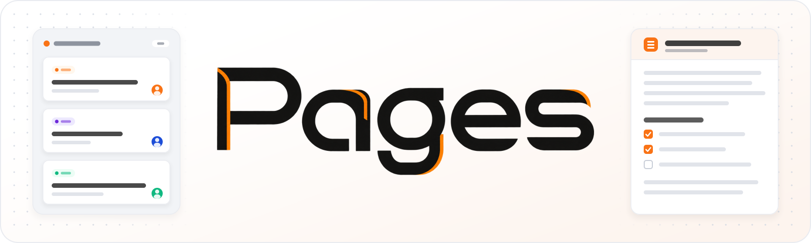

<p align="center">
  
</p>

# Pages

Self-hosted project management and wiki for teams. Plan work, track tickets
and keep project knowledge together in one instance, with server-enforced
roles, groups and department access. Pages is in early development (0.1.0).

## About

- Projects, Kanban boards and ticket lists, hierarchies, milestones and attachments.
- Project and instance wiki pages with search, an editor, attachments and trash.
- Optional GitHub issue synchronization, Discord notifications and Google Drive Storage.
- Pica chat, agent plans and automations using administrator-configured connections.
- English and German interface, light/dark/system mode and personal design themes.

The banner is an illustration. Native Pica Mobile is a separate project; this
repository contains its [server protocols and push support](docs/PicaMobileWebSocket.md).

## Getting started

The commands below are for local development on a Unix-like shell. They were
checked against source and scripts on 2026-11-13; a clean installation and
browser setup were **not run** for this documentation change. The targeted
checks and boundaries are recorded in the [verification report](docs/PAGE-332.md).

### Requirements

- Git and **Node.js >=22.22.0**; CI uses Node.js 24.
- **pnpm 11.23.0**, pinned by `packageManager` in [package.json](package.json).
  The engine minimum is pnpm 10; use the pinned version for this checkout.
- A dedicated, empty **PostgreSQL** development database and role. PostgreSQL 18
  is used by the repository's database tools. Prepare the encoding, locale and
  permissions using [Local development database](docs/PostgresMigration.md#local-development-database).
- A separate development OS account with its own home directory and no production
  environment secrets. Both development and production default to that account's
  `~/.pages/config.toml`; a separate checkout alone does **not** separate data.

### Install and run

As the development account:

```sh
git clone https://github.com/gesus90/Pages.git
cd Pages
pnpm install --frozen-lockfile
```

Start the API in one terminal, from the checkout:

```sh
pnpm run dev:api
```

Start the browser app in another terminal, under the **same development account**:

```sh
pnpm run dev
```

The app normally opens at `http://localhost:5173`; the API uses port 5174.
Use the app's actual printed address if Vite selects another port. If you change
the API address, set `PAGES_DEV_API` for the app process; see
[Development commands](docs/Development.md#commands).

For the first setup, copy the **`/setup?token=…` path printed by the API** onto
that app address, for example `http://localhost:5173/setup?token=…`.
The token is secret. The wizard asks for the company name, language, first
administrator and PostgreSQL connection URL. It initializes the empty database
and saves the instance configuration; it creates no DuckDB database file.
Sign in with the administrator you just created. AI credentials are optional
for core project/wiki development; native agent execution has
[additional Linux/runtime requirements](docs/AgentRuntime.md).

Installation uses the lockfile and the repository's ten-day package release-age
policy. Pages does not automatically load `.env`; export optional variables
explicitly as described in [.env.example](.env.example).

## Data and architecture

Pages uses a **static React Router browser app and an API server**, rather than
per-request page rendering. Loaders/actions and authorization run on the server.
The [architecture and source references](docs/Development.md#architecture)
explain the split and build-time app shell generation.

**PostgreSQL is the only runtime database.** `databaseUrl` is required after
setup. The legacy `databasePath` names the application data directory through
its parent; its `pages.duckdb` filename does not select a runtime backend.
Keep PostgreSQL data, instance configuration, attachments, encryption keys,
CLI logins and agent records separate from source and from other instances.
See [configuration and paths](docs/Operations.md),
[database behavior](docs/DatabaseExecutor.md) and
[migration, backup and restore](docs/PostgresMigration.md).

## Documentation

[Browse the documentation index](docs/README.md) for all topics and older ticket evidence.
Repository links work in this checkout and its Git hosting; private instance
wiki pages are not required to follow these guides. Some specialized guides
are in German.

| Task | Guide |
| --- | --- |
| Use navigation, drafts, archives and themes | [User guide](docs/UserGuide.md) |
| Configure and operate an instance | [Operations](docs/Operations.md), [systemd services](docs/PlatformServices.md), [reverse proxy](deploy/proxy/README.md) |
| Connect GitHub, Discord or Google Drive | [Integrations](docs/IntegrationsService.md), [Storage and Google sign-in](docs/StorageApi.md) |
| Use Pica or run agent plans | [Pica](docs/Pica.md), [plans](docs/AgentPlanRunner.md), [tools and ACP adapters](docs/AgentRuntime.md) |
| Develop and validate changes | [Development](docs/Development.md), [unit scopes and CI test tags](tests/README.md), [browser tests](tests/browser/README.md) |

## Contributing

Read [GUIDELINES.md](GUIDELINES.md) before changing source; coding agents must
also follow [AGENTS.md](AGENTS.md). Keep changes focused and add relevant
behavior tests with mocked external boundaries. The
[development guide](docs/Development.md) covers repository layout and commands;
[tests/README.md](tests/README.md) explains the separate Backend/Frontend scopes
and CI test tags. Follow the validation scope of your assignment and report
only checks actually executed.

## Security notes

- **No secrets in the repository.** Keep `config.toml`, database data, instance
  keys, `agents/` CLI logins and `Agents/` records outside the working tree.
  `.env` is ignored; [.env.example](.env.example) holds placeholders only.
- **Do not experiment with production data.** Use a separate development account
  (or an explicitly isolated HOME for every process), configuration, database,
  role and file storage. Test migrations on isolated copies, preserving originals.
- **Treat the setup link as a secret.** Anyone with a valid pending setup link
  can create the first administrator. Protect the operator console and its capture.

## License

Pages is open source under the [MIT License](LICENSE).
React Flow (`@xyflow/react` and `@xyflow/system`) is MIT licensed; its complete
[copyright and license notice](assets/react-flow-LICENSE.txt) remains with the
source. The editor uses the free library with hidden corner attribution; no
Pro assets or services are required. Further asset notices are in the
[documentation index](docs/README.md#licenses-and-assets).
